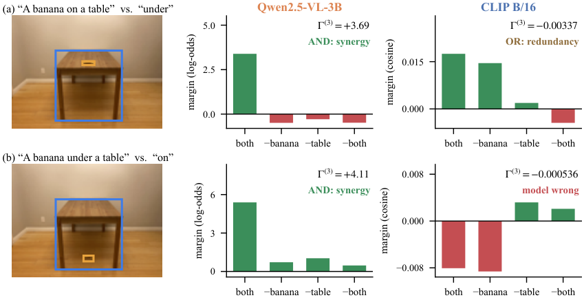
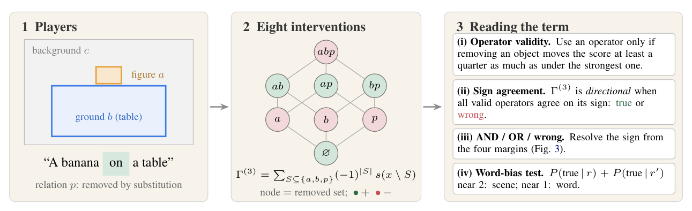
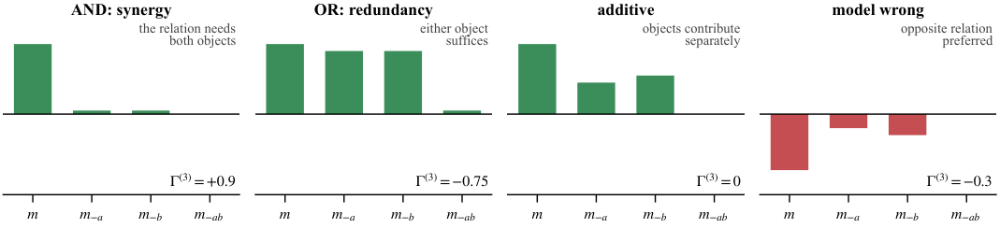
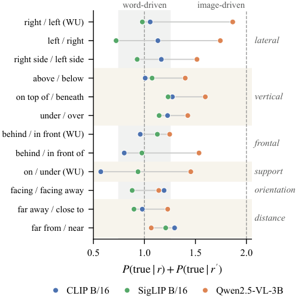
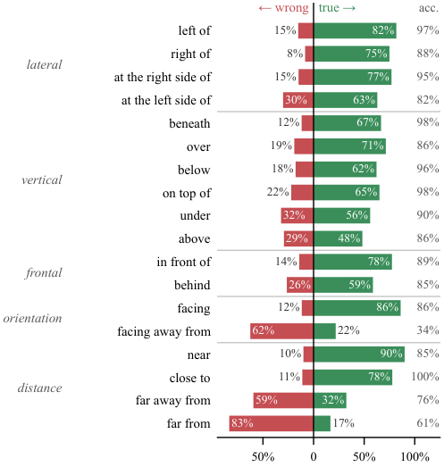

# Left of, Behind, Facing Away: Where Vision–Language Models Stop Grounding Space

Code and data for **Relational Interaction Attribution (RIA)**, a method that asks whether a vision–language model grounds a spatial relation such as *on*, *behind* or *facing* in the configuration of **two** objects, or merely recognises the objects and prefers a word.



*Qwen2.5-VL prefers the true relation only when the banana and the table are both visible (synergy). CLIP prefers "on" in both photographs, and its preference survives removing the banana.*

---

## Why third order?

Spatial prepositions are two-place predicates: they relate a *figure* to a *ground*. A saliency map gives one number per region, so it highlights the banana and the table whether or not the model read *on*. Pairwise (region × word) interactions cannot express a two-place predicate either.

RIA measures the **third-order interaction** between the figure's region *a*, the ground's region *b* and the relation phrase *p*:

```
G3(a, b, p) = Σ_{S ⊆ {a, b, p}} (-1)^|S| · s(x with S removed)
```

This is the Harsanyi dividend of the triple. It is zero whenever the effect of *p* splits into separate contributions of *a* and *b*, and nonzero only when the model's use of *p* depends on both objects **together**. When the phrase is removed by substituting its opposite (*on* → *under*), G3 equals the part of the model's preference for the true relation that requires both objects:

```
G3 = m − m₋ₐ − m₋ᵦ + m₋ₐᵦ        (m = score(true caption) − score(opposite caption))
```



A third-order term is easy to compute and easy to misread, so RIA reads it with four checks:

1. **Operator validity.** A removal operator is used only if removing an object moves the score at least a quarter as much as the strongest operator. Replacing Qwen2.5-VL's visual tokens fails: a median effect of 0.17 log-odds, against 4.6 for blurring.
2. **Sign agreement.** G3 counts as *directional* only if every valid operator agrees on its sign.
3. **AND / OR / wrong.** A negative G3 is not evidence for the opposite relation. Redundancy, where either object alone reveals the relation, makes G3 negative by construction.

   

4. **Word-bias test.** For an opposite pair (r, r′), `P(true | r) + P(true | r′)` is near 2 when joint evidence follows the scene and near 1 when it favours one word whatever the scene. The excess over 1 is Youden's J of the joint term as a detector of r.

## Main findings

| | CLIP B/16 | SigLIP B/16 | Qwen2.5-VL-3B |
|---|---|---|---|
| Prefers the true relation (What's Up / VSR) | 54% / 52% | 52% / 53% | 97% / 87% |
| G3 true vs wrong direction, What's Up | 21% vs 25% | 24% vs 22% | **74% vs 16%** |
| G3 true vs wrong direction, VSR | 26% vs 25% | 24% vs 25% | **64% vs 25%** |
| Synergy (AND) among directional images, What's Up | 46% | 52% | **82%** |

- **Dual encoders use both objects, but not for the relation.** Their joint terms point the true and the wrong way equally often, and word-bias sums stay between 0.57 and 1.30 for every class of relation.
- **Qwen2.5-VL grounds the projective relations** on the lateral, vertical and frontal axes (word-bias sums 1.40–1.87), mostly through synergy. Most of its "wrong-direction" evidence is redundancy, concentrated in *behind* and *on*.
- **…but treats orientation and distance as words.** For *facing / facing away from* and *near / far from*, its sums fall to 1.07–1.23, the encoders' range. It accepts *facing away from* for only 34% of true captions.
- **G3 does not predict failures** on 2,313 compositional hard negatives (SugarCrepe, ARO). A first-order quantity from the same interventions, **relation reliance**, does: CLIP .577 → .701 AUROC, SigLIP .684 → .733, beyond confidence and text similarity.
- **The instrument is sound.** Held-out deletion faithfulness is .63–.85, against .08–.48 for gradient maps. It passes model-randomisation and task-conditioning checks, and computing all 27 configurations takes about 1 s per image on a T4.

<p align="center">
 &nbsp; 
</p>

---

## Installation

```bash
git clone https://github.com/anshul-2010/RIA-Beyond-Saliency.git
cd RIA-Beyond-Saliency
python -m venv .venv && source .venv/bin/activate       # Windows: .venv\Scripts\activate
pip install -r requirements.txt
python -m spacy download en_core_web_sm                 # only for free-form captions (SugarCrepe)
pip install -e .                                         # optional: import ria from anywhere
```

Python ≥ 3.10. Experiments used `transformers==4.52.4` (pinned in `requirements.txt`). CLIP and SigLIP run on CPU. Qwen2.5-VL-3B needs a GPU with about 16 GB (a T4 suffices).

## Quickstart

```bash
python examples/quickstart.py
```

This builds a synthetic image (a red square above a blue circle), computes RIA with CLIP under the three removal operators, and prints the four margins, G3 and the verdict:

```
operator          m      m_-a      m_-b     m_-ab        G3
drop         0.0002   -0.0020   -0.0014   -0.0013    0.0024
blur         0.0002   -0.0028   -0.0048   -0.0065    0.0012
mean         0.0002   -0.0028   -0.0018   -0.0036    0.0012
verdict: directional, TRUE: the preference for the true relation needs both objects
```

To run your own image, give the caption, the relation, its opposite and the two boxes (original pixels):

```bash
python examples/quickstart.py --image photo.jpg --caption "A cup on a table" \
    --relation on --opposite under --subj-box 210 80 300 160 --obj-box 60 150 460 420
```

A single image is an illustration, not evidence. CLIP's margin above is tiny (0.0002), and the paper's conclusions rest on dataset-level directional rates and the word-bias test.

As a library:

```python
from ria.scorers import make_scorer
from ria.datasets.common import item_input
from ria.interactions import memoize, relational_triple

scorer = make_scorer("openai/clip-vit-base-patch16")                 # or SigLIP / Qwen2.5-VL
it = item_input(image, "A cup on a table", "on", ["under"], cup_box, table_box, scorer.size)
game = memoize(scorer.with_operator("blur").game(it.image, it.caption, it.regions, [it.phrase]))
r = relational_triple(game, "subj", "obj", "rel")
print(r.triple, r.rho, r.effect, r.pair)                                # G3, relational share, first/second order
```

---

## Reproducing the paper

`reproduce.sh` has two modes.

```bash
bash reproduce.sh analyse        # every table and figure from per-image records (CPU, minutes)
bash reproduce.sh run <exp>      # rerun an experiment from scratch (GPU for Qwen)
```

**From the released records, with no GPU.** Download `ria_records.zip` (27 MB) from the [Releases page](https://github.com/anshul-2010/RIA-Beyond-Saliency/releases), unzip it in the repository root to obtain `results/`, then run `bash reproduce.sh analyse`. The archive holds the per-image records of every run the paper reports (19 runs); `scripts/pack_records.py` builds it from a local `results/` folder.

| Paper result | Experiment (`run`) | Script | Analysis |
|---|---|---|---|
| What's Up: direction, types, word bias (Fig. 1, 4, 5; Tab. 1) | `e2` | `scripts/e2_whatsup.py` | `scripts/analyze_e2.py` |
| VSR replication, per-relation classes (Fig. 6) | `vsr` | `scripts/e2_vsr.py` | `scripts/analyze_e2.py` |
| Failure prediction on hard negatives (Tab. 2) | `e3` | `scripts/e3_hardneg.py` | `scripts/analyze_e3.py`, `scripts/e3_text_control.py` |
| By part of speech | (uses `e3`) | | `scripts/analyze_e6.py` |
| Phrase localisation (Flickr30k Entities) | `e1` | `scripts/e1_flickr.py` | `scripts/analyze_e1.py` |
| Operator / substitute stability | (uses `e2`, `e3`) | | `scripts/analyze_e4.py` |
| Paraphrase stability | `paraphrase` | `scripts/e4_paraphrase.py` | (prints its table) |
| Model randomisation, task conditioning | `sanity` | `scripts/e5_sanity.py`, `scripts/e5_task_conditioning.py` | (print their tables) |
| Held-out deletion faithfulness | (uses `e2`) | | `scripts/analyze_faithfulness.py` |
| Background-averaged term (Banzhaf index) | `t05` | `scripts/t05_context_average.py run` | `… analyse` |
| Substitute-lexicon sensitivity | `t07` | `scripts/e3_hardneg.py --substitutes contrast` | `scripts/t07_lexicon.py` |
| FIxLIP comparison | `fixlip` | `scripts/e2_whatsup.py --config configs/e2_fixlip_*.json` | `scripts/compare_fixlip.py` |
| Cost | (uses all) | | `scripts/analyze_cost.py` |
| Appendix tables and figures | | | `scripts/coling_tables.py`, `scripts/coling_figures.py` |

Every run writes `results/<timestamp>_<name>/config.json` (all arguments, seed, code commit, environment) and `results.jsonl` (one record per image). The analysis scripts read the latest run of each name. **No number in the paper is typed by hand**: each comes from these records.

### Data

Loaders download What's Up, VSR (with its COCO images), SugarCrepe, ARO and Flickr30k Entities from their official sources on first use. The OWLv2 boxes used in the paper are included in [`data/boxes/`](data/boxes/), so results do not depend on rerunning the detector. **Winoground is not distributed and not downloaded.** Its licence forbids redistribution. To run `scripts/winoground_local.py`, place your own licensed copy in a `winoground/` folder next to this repository; nothing derived from it is written inside the repository.

### Hardware used

Kaggle notebooks with one NVIDIA T4 (16 GB) for all GPU runs (Python 3.13, PyTorch 2.11 with CUDA 12.8, Transformers 4.52.4, as recorded in every run's `config.json`), and a CPU-only laptop for development and the CPU checks. The largest single run (Qwen2.5-VL-3B on 2,313 hard negatives) took about 5.5 GPU-hours. `scripts/kaggle_run.py` is an optional helper that ran these jobs on Kaggle using your own Kaggle credentials; every experiment also runs locally.

---

## Limitations

**Scientific**, as discussed in the paper:

- **Scope.** Three base-size models (CLIP ViT-B/16, SigLIP base/16, Qwen2.5-VL-3B), two spatial datasets and English captions only. Larger models and other languages may behave differently. Some VSR classes are small (18–43 images per orientation or distance relation).
- **Regions.** Boxes come from an open-vocabulary detector. About a third of VSR and hard-negative items have a low-confidence box; results on confident items match the full sets.
- **Interventions.** Every removal operator takes the input out of distribution. RIA mitigates this with several operators, a validity check and sign agreement, but cannot eliminate it.
- **Contrastive by design.** The phrase is removed by substitution, so G3 measures evidence for a relation *over a specific alternative*.
- **Locality.** G3 keeps all other players present. Averaging over the background (the Banzhaf index, `t05`) leaves the conclusions unchanged, but other forms of context are not covered.
- **Negative result.** The finding that G3 does not predict failures covers two benchmarks and two substitute lexicons; other feature designs might find value in third-order terms.
- **Frames of reference.** Captions do not specify whether *left of* is meant from the viewer's or the object's perspective, and RIA does not control for this.
- **Exploratory test.** A held-out counterfactual test on What's Up pairs did not replicate on Winoground, so no claim is made from it.

**Practical**, what you will meet when running the code:

- **fp16 overflow.** Qwen2.5-VL runs in float16 on GPU and overflows to a non-finite score on about 1% of items (11 VSR images, 15 hard negatives). Analyses drop these records explicitly.
- **SigLIP patch dropping.** SigLIP has no class token, so dropping the patches of *every* region leaves its pooling head with nothing to attend to. The background-averaged analysis therefore uses blur and mean only for SigLIP.
- **Link rot.** VSR images are fetched from COCO URLs, and links can break. The released boxes do not depend on them, but rerunning VSR does.
- **Cost comparison.** FIxLIP's default budget does not fit on a 16 GB GPU, so its timings were measured on CPU at a reduced budget. The cost ratio to RIA mixes hardware with method.
- **Numerical precision.** Absolute scores can differ in the last digits across GPUs in fp16. The paper's conclusions use sign agreement and rates, which are robust to this.
- **Test downloads.** Tests that load a model (`test_scorers`, `test_contrastive`, `test_baselines`, `test_qwen_scorer`, `test_whatsup_loader`) download weights and data on first run and are slow on CPU. `tests/test_interactions.py` checks the algebra (dividends, G3, the purely relational case) with no model; `tests/test_contrastive.py` checks the margin identity on CLIP.

---

## Repository layout

```
ria/                 library: interactions (dividends, G3), players (regions, phrases), scorers
                     (CLIP, SigLIP, Qwen2.5-VL), baselines (Grad-CAM, Chefer, FIxLIP wrapper),
                     OWLv2 detection, dataset loaders, relation-argument parser
scripts/             one script per experiment, analysis scripts, figure and table generators,
                     pack_records.py (bundles results/ for release)
configs/             exact run configurations used in the paper
data/boxes/          OWLv2 boxes for What's Up, VSR and the hard negatives (CC BY 4.0)
examples/            quickstart
tests/               unit tests (margin identity, dividends, regions, loaders, scorers)
assets/              figures for this README
reproduce.sh         rerun experiments or regenerate every table from records
```
## Acknowledgements and licences

Code: [MIT](LICENSE). Boxes in `data/boxes/`: [CC BY 4.0](data/boxes/README.md); they annotate images from datasets that keep their own licences.

This work builds on What's Up (Kamath et al., 2023), VSR (Liu et al., 2023), SugarCrepe (Hsieh et al., 2023), ARO (Yuksekgonul et al., 2023), Flickr30k Entities (Plummer et al., 2015), COCO (Lin et al., 2014) and Winoground (Thrush et al., 2022); on CLIP, SigLIP, Qwen2.5-VL and OWLv2; and on the official [FIxLIP](https://github.com/hbaniecki/fixlip) code (MIT, Baniecki et al., 2025), which `scripts/setup_fixlip.py` clones at a pinned commit.
